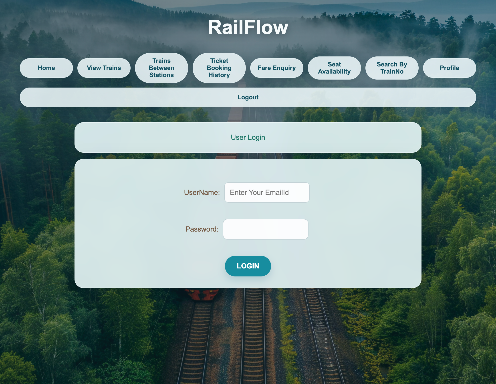
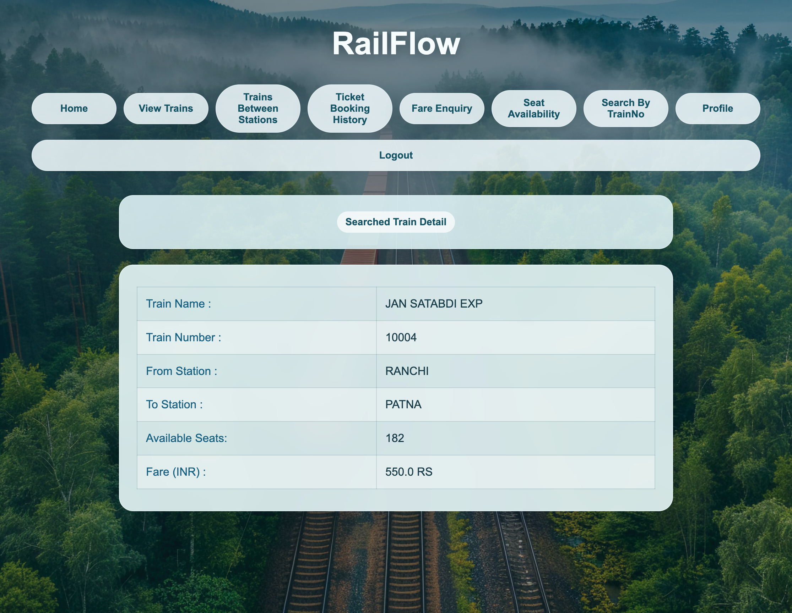
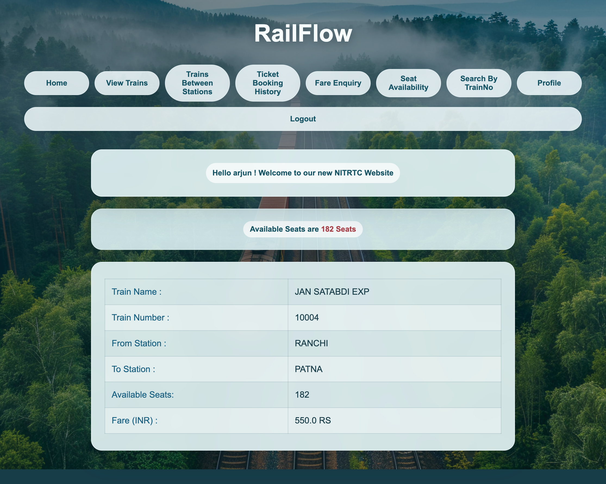
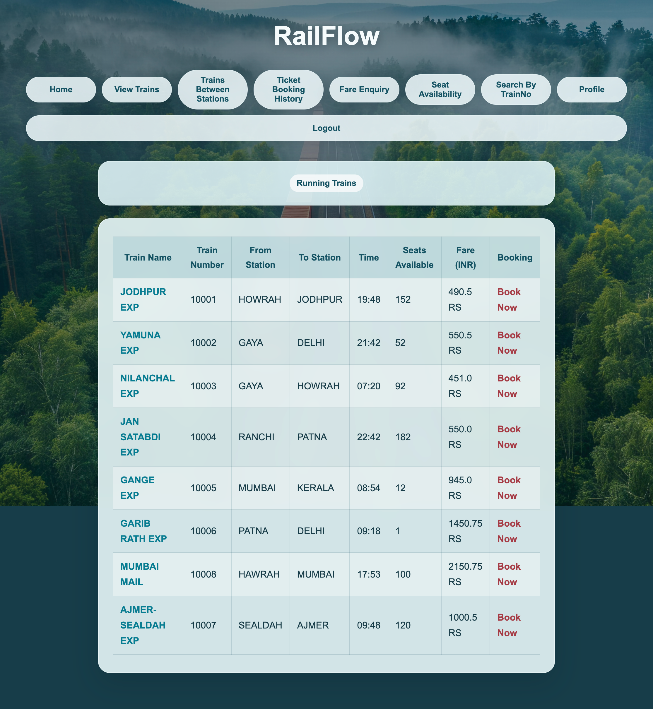

# RailFlow

A Java-based web application for searching trains, checking availability and fares, and managing ticket reservations.  
**Technologies:** Java, Servlets, JDBC, Oracle SQL, HTML, CSS, Bootstrap

---

## Project Overview

RailFlow is a web application designed to simplify train information searches and ticket reservation management.

Users can register, log in, search for trains between stations, check fares, book tickets, and view their booking history. Administrators can manage train information through dedicated administrative functionality.

This project is being used to study Java web development, database connectivity, and the architecture of web applications.


## Screenshots


### 1. Login Interface


### 2. Train Search


### 3. Train Enquiry


### 4. Railway Home Page


---

## Features

### User Features

- User registration and login
- View available trains
- Search for trains between stations
- Check train availability
- View train schedules and fares
- Book train tickets
- View booking details
- Access booking history
- View and update profile information
- Change password
- Log out

### Administrator Features

- Administrator login
- Add new trains
- View available trains
- Update train information
- Remove or cancel trains
- Manage profile information
- Log out

### Additional Features

The original project also advertises payment processing and ticket booking history. Refer to the implementation to verify the functionality of each feature.

---

## Technology Stack

### Frontend
- HTML
- CSS
- Bootstrap

### Backend
- Java (J2EE / Java EE)
- Java Servlets
- JDBC

### Database
- Oracle SQL

### Development Tools
- Git
- Java Development Kit (JDK)
- Eclipse IDE for Enterprise Java and Web Developers
- Apache Maven
- Apache Tomcat
- Oracle SQL Developer or SQL*Plus

> Note: This project uses Java Servlets and JDBC. It does not use Spring Boot.

---

## Application Architecture

The application follows a traditional Java web application architecture.

```text
User
  |
  v
Frontend (HTML, CSS, Bootstrap)
  |
  v
Java Servlets
  |
  v
Application Logic
  |
  v
JDBC
  |
  v
Oracle Database
```

The frontend provides the user interface. Java Servlets handle web requests, application logic processes operations, and JDBC enables communication with the Oracle database.

---

## Database Structure

The database setup described in the original project contains four tables.

| Table | Purpose |
|---|---|
| `CUSTOMER` | Stores customer information |
| `ADMIN` | Stores administrator information |
| `TRAIN` | Stores train details, routes, available seats, and fares |
| `HISTORY` | Stores ticket booking information |

The `HISTORY` table includes booking identifiers, customer references, train numbers, travel dates, source and destination stations, seat counts, and booking amounts.

### Database Setup

The original setup instructions use Oracle SQL*Plus or Oracle SQL Developer.

**Important:** The SQL below is adapted from the original project. Use a local development database and avoid granting unnecessary administrative privileges to application accounts.

#### Step 1: Create the database user

Connect to Oracle using an account authorized to create users.

```sql
CREATE USER RESERVATION IDENTIFIED BY "ChooseYourOwnPassword";
GRANT CREATE SESSION, CREATE TABLE TO RESERVATION;
```

Depending on your Oracle version and configuration, additional privileges may be required.

#### Step 2: Connect as the reservation user

```sql
CONNECT RESERVATION/"ChooseYourOwnPassword";
```

#### Step 3: Create the tables

```sql
CREATE TABLE CUSTOMER (
    MAILID VARCHAR2(40) PRIMARY KEY,
    PWORD VARCHAR2(128 CHAR) NOT NULL,
    FNAME VARCHAR2(20) NOT NULL,
    LNAME VARCHAR2(20),
    ADDR VARCHAR2(100),
    PHNO NUMBER(12) NOT NULL
);

CREATE TABLE ADMIN (
    MAILID VARCHAR2(40) PRIMARY KEY,
    PWORD VARCHAR2(128 CHAR) NOT NULL,
    FNAME VARCHAR2(20) NOT NULL,
    LNAME VARCHAR2(20),
    ADDR VARCHAR2(100),
    PHNO NUMBER(12) NOT NULL
);

CREATE TABLE TRAIN (
    TR_NO NUMBER(10) PRIMARY KEY,
    TR_NAME VARCHAR2(70) NOT NULL,
    FROM_STN VARCHAR2(20) NOT NULL,
    TO_STN VARCHAR2(20) NOT NULL,
    SEATS NUMBER(4) NOT NULL,
    FARE NUMBER(6,2) NOT NULL
);

CREATE TABLE HISTORY (
    TRANSID VARCHAR2(36) PRIMARY KEY,
    MAILID VARCHAR2(40)
        REFERENCES CUSTOMER(MAILID),
    TR_NO NUMBER(10),
    "DATE" DATE,
    FROM_STN VARCHAR2(20) NOT NULL,
    TO_STN VARCHAR2(20) NOT NULL,
    SEATS NUMBER(3) NOT NULL,
    AMOUNT NUMBER(8,2) NOT NULL
);
```

Passwords are stored as salted PBKDF2 hashes. Do not seed the public deployment with shared administrator credentials or real personal data. Users can register accounts through the application.

#### Step 4: Verify the tables

```sql
SELECT * FROM CUSTOMER;
SELECT * FROM ADMIN;
SELECT * FROM TRAIN;
SELECT * FROM HISTORY;
```

For an existing database, apply [`database/security-migration.sql`](./database/security-migration.sql) before deploying this version. It widens password columns for the hashes and removes the original publicly known demo accounts and their sample history.

---

## Installation and Setup

The original project documentation describes running the application through Eclipse and Apache Tomcat.

### Prerequisites

Install the following software as required by the project:

- Git
- A compatible JDK
- Eclipse IDE for Enterprise Java and Web Developers
- Apache Maven
- A compatible Apache Tomcat version
- Oracle Database
- Oracle SQL Developer or SQL*Plus

The original setup guide targets an older Java web application environment. Compatibility adjustments may be necessary with newer Java and Tomcat versions.

### Step 1: Clone the repository

```bash
git clone https://github.com/manjush007/-Train-Ticket-Reservation-System.git
```

### Step 2: Enter the project directory

```bash
cd -Train-Ticket-Reservation-System
```

If the directory name on your computer differs, use the actual directory name.

### Step 3: Build with Maven

```bash
mvn clean install
```

Resolve any dependency or compatibility errors before continuing.

### Step 4: Configure the database

Create the Oracle database tables. Set these environment variables in your hosting provider's secret/configuration settings:

- `DATABASE_URL` — Oracle JDBC URL, for example `jdbc:oracle:thin:@//db-host:1521/FREEPDB1`
- `DATABASE_USERNAME` — a least-privilege application database user
- `DATABASE_PASSWORD` — that user's password

The app reads connection credentials from the environment, not from the committed properties file. Never expose the database port publicly; allow access only from the app host or private network.

For local development, set the same variables in the terminal before starting the app. Do not commit credentials or use real personal data in a portfolio demo.

Example for the local Oracle Free container:

```bash
export DATABASE_URL='jdbc:oracle:thin:@localhost:1521/FREEPDB1'
export DATABASE_USERNAME='RESERVATION'
export DATABASE_PASSWORD='your-local-database-password'
mvn clean package
java -jar target/dependency/webapp-runner.jar --port 8081 target/TrainBook-1.0.0-SNAPSHOT.war
```

For a public demo, set the database values as private environment variables in the hosting provider instead of using this local example. Start with a fresh demo database; do not copy real customer records.

### Step 5: Configure Tomcat

Import the project into Eclipse as an existing Maven project. Configure a compatible Tomcat server and deploy the web application.

This project builds a WAR file. Deploy `target/TrainBook-1.0.0-SNAPSHOT.war` to a compatible Tomcat host or run it with the included webapp runner. A public deployment must use HTTPS and a private database connection.

The host provides the public URL; `localhost` URLs are only accessible from the server itself.

---


## Learning Objectives

This repository is being used to explore the following concepts:

- Core Java and object-oriented programming
- Java Servlets and HTTP request handling
- JDBC and relational database connectivity
- SQL queries and database relationships
- CRUD operations
- Traditional Java web application architecture
- Maven-based project builds
- Git and GitHub workflows

The goal is to build a deeper understanding of how Java web applications are structured and how their components interact.

---

## Maintainer

**Manjush Premkumar**

This repository is maintained for learning, experimentation, and documenting improvements to Java web application development.
